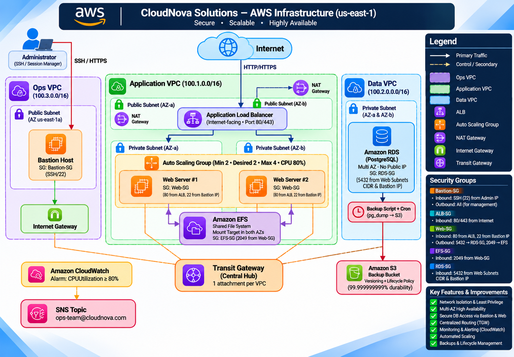

# ☁️ CloudNova Enterprise AWS Infrastructure

### Secure • Scalable • Highly Available • Monitored

A production-oriented AWS infrastructure architecture designed for CloudNova Solutions to provide a secure, scalable, and highly available environment for hosting web applications, managing databases, sharing files, and automating backups.

---

## 📌 Project Overview

CloudNova Solutions is a growing technology company that requires a reliable cloud infrastructure to support its application, data, and operations teams.

This project demonstrates the design and implementation of a multi-VPC AWS architecture that provides:

- Secure network isolation.
- High availability across multiple Availability Zones.
- Scalable application hosting.
- Centralized network connectivity.
- Private database access.
- Shared file storage.
- Automated database backups.
- Infrastructure monitoring and alerting.

The architecture follows AWS security and networking best practices, applying network segmentation and least-privilege access wherever possible.

---

## 🏗️ Architecture Diagram


**AWS Region:** US East (N. Virginia) — `us-east-1`

The infrastructure is divided into three independent VPCs connected through a centralized Transit Gateway.

---

## ☁️ AWS Services Used

| AWS Service | Purpose |
|---|---|
| Amazon VPC | Network isolation and segmentation |
| EC2 | Application and Bastion instances |
| Application Load Balancer | Public application entry point |
| Auto Scaling Group | Automatic application scaling |
| NAT Gateway | Controlled outbound internet access |
| Internet Gateway | Internet connectivity for public subnets |
| Amazon RDS (PostgreSQL) | Managed relational database |
| Amazon EFS | Shared file storage across Availability Zones |
| Amazon S3 | Database backup storage |
| AWS Transit Gateway | Centralized connectivity between VPCs |
| Amazon CloudWatch | Infrastructure monitoring and alarms |
| Amazon SNS | Email notifications and alerts |

---

## 🌐 Network Architecture

The infrastructure consists of three isolated VPCs:

### 1. Operations VPC

**CIDR:** `100.3.0.0/16`

Designed for infrastructure administration and operational management.

Components:

- Public Subnet.
- Bastion Host (EC2).
- Internet Gateway.

The Bastion Host provides a controlled SSH access point for administrators to manage private infrastructure resources.

### 2. Application VPC

**CIDR:** `100.1.0.0/16`

Hosts the web application infrastructure.

Components:

- Public Subnets across multiple Availability Zones.
- Private Application Subnets.
- Internet-facing Application Load Balancer.
- Auto Scaling Group.
- EC2 Web Servers.
- NAT Gateways.
- Amazon EFS.

**Traffic Flow:**

Internet → Application Load Balancer → Private EC2 Instances

The application servers are not directly exposed to the public internet.

The Auto Scaling Group is configured with:

- Minimum Capacity: 2
- Desired Capacity: 2
- Maximum Capacity: 4
- CPU Scaling Threshold: 80%

### 3. Data VPC

**CIDR:** `100.2.0.0/16`

Dedicated to database and backup services.

Components:

- Private Subnets across Availability Zones.
- Amazon RDS (PostgreSQL).
- Database backup process.
- Amazon S3 Backup Bucket.

The RDS instance is configured without a public IP address.

Database access is restricted through security group rules.

---

## 🔐 Security Architecture

Security is implemented using network isolation and Security Groups.

### Bastion Security Group

- Inbound: SSH (Port 22) from authorized administrator IP.
- Outbound: Required management traffic.

### Application Load Balancer Security Group

- Inbound: HTTP (Port 80) from the internet.
- Inbound: HTTPS (Port 443) from the internet.

### Web Server Security Group

- Inbound: HTTP (Port 80) from ALB Security Group.
- Inbound: SSH (Port 22) from Bastion Security Group.
- Outbound: Required application and infrastructure traffic.

### EFS Security Group

- Inbound: NFS (Port 2049) from Web Server Security Group.

### RDS Security Group

- Inbound: PostgreSQL (Port 5432) from authorized application and management sources.

**Security Principles:**

- Least Privilege Access.
- Private Database Connectivity.
- Network Segmentation.
- Restricted Administrative Access.
- Security Group-Based Traffic Control.

---

## 🔄 Shared Storage — Amazon EFS

Amazon EFS provides a shared file system for application servers.

Both EC2 instances mount the same EFS file system.

Benefits:

- Shared application files.
- Multi-AZ accessibility.
- Persistent shared storage.
- Scalable file system capacity.

---

## 💾 Backup & Disaster Recovery

Database backups are handled through a scheduled backup process.

**Backup Workflow:**

1. PostgreSQL database backup using `pg_dump`.
2. Backup file generation.
3. Upload backup to Amazon S3.
4. S3 Versioning enabled.
5. Lifecycle policies for backup management.

This provides a reliable approach to database backup retention and recovery.

---

## 📊 Monitoring & Notifications

Amazon CloudWatch monitors infrastructure performance.

A CPU utilization alarm is configured with an 80% threshold.

**Alert Workflow:**

EC2 CPU Utilization ≥ 80%

↓

Amazon CloudWatch Alarm

↓

Amazon SNS Topic

↓

Operations Team Email Notification

The notification endpoint is:

`ops-team@cloudnova.com`

---

## 🔗 Centralized Networking — Transit Gateway

AWS Transit Gateway acts as the central networking hub connecting the three VPCs.

Connected environments:

- Operations VPC.
- Application VPC.
- Data VPC.

Each VPC connects through a Transit Gateway attachment.

This architecture simplifies communication between environments and provides a scalable foundation for future network expansion.

---

## 🚀 Key Features

- Multi-VPC Network Architecture.
- Multi-AZ High Availability Design.
- Secure Bastion Host Administration.
- Internet-Facing Application Load Balancer.
- EC2 Auto Scaling.
- Private PostgreSQL Database.
- Shared Storage Using Amazon EFS.
- Centralized Routing with Transit Gateway.
- Automated Database Backup Workflow.
- S3 Versioning and Lifecycle Management.
- CloudWatch Monitoring and SNS Notifications.

---

## 🛠️ Skills Demonstrated

**Cloud Computing**
- AWS Infrastructure Design.
- AWS Networking.
- High Availability Architecture.
- Cloud Security.

**Networking**
- VPC Design.
- Public and Private Subnets.
- Route Tables.
- NAT Gateway.
- Internet Gateway.
- Transit Gateway.
- Security Groups.

**Compute & Storage**
- Amazon EC2.
- Application Load Balancer.
- Auto Scaling Groups.
- Amazon EFS.
- Amazon RDS.
- Amazon S3.

**Monitoring & Automation**
- Amazon CloudWatch.
- Amazon SNS.
- Linux Shell Scripting.
- PostgreSQL Backup Automation.

---

## 📁 Project Structure

```text
CloudNova-AWS-Infrastructure/
│
├── README.md
├── docs/
│   └── images/
│       └── aws-architecture.png
├── scripts/
│   └── backup.sh
├── screenshots/
└── .gitignore
```

---

## 🎯 Project Objectives

The main objective of this project is to demonstrate how AWS services can work together to build a secure, scalable, and highly available cloud infrastructure.

It also demonstrates practical knowledge of cloud networking, infrastructure security, monitoring, storage, and automation.

---

## 👨‍💻 Author

**Your Name**

Cloud & DevOps Enthusiast

GitHub: [Your GitHub Profile](https://github.com/ans-mohamed)

---

⭐ If you find this project interesting, feel free to explore the architecture and its implementation.
